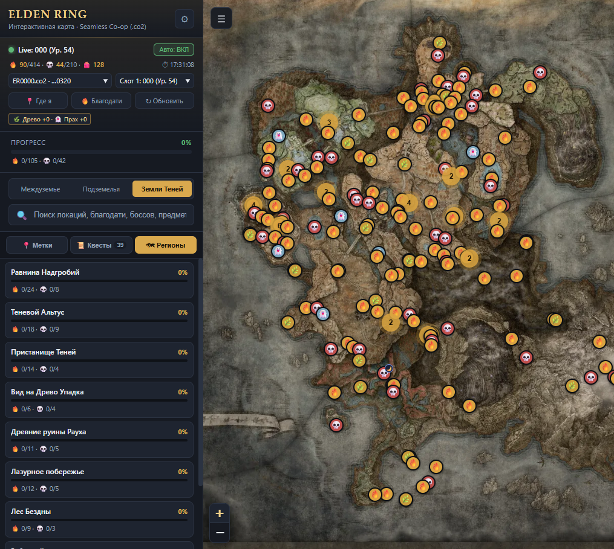

# Elden Ring Seamless Co-op Live Map Tracker

Интерактивная офлайн-карта и live-трекер прогресса для **Elden Ring** и **Seamless Co-op** (`.co2` / `.sl2`), работающий локально в браузере и фоново в системном трее Windows.

Приложение в реальном времени (только чтение) считывает бинарные сохранения игры из `%APPDATA%\EldenRing`, автоматически отмечает открытые места благодати, побеждённых боссов, собранную экипировку и благословения DLC, отслеживает этапы 39 квестовых линий и показывает текущее положение вашего персонажа на карте.


---

## Масштаб базы данных

| Раздел | В базе v1.3.0 |
| :--- | :--- |
| **Слои карты** | **3 слоя**: Междуземье (`1 497`), Подземелья (`121`), Земли Теней DLC (`506`) — всего **2 124 маркера** в **24 категориях** |
| **Места благодати** | **414** точек на поверхности, в подземельях и в DLC |
| **Боссы** | **210** боссов (**152** карточки описаний, **194** таблицы наград/дропа на русском) |
| **Снаряжение и коллекционка** | **873** отслеживаемых предмета (оружие, броня, талисманы, заклинания, прах духов, пеплы войны, слёзы, камни памяти, а также **42** точки Осколков Древа Упадка и **23** точки Праха почитаемого духа) |
| **Квесты и NPC** | **39** сюжетных цепочек с авто-детекцией шагов по флагам сохранения и **75** динамических NPC (**312** позиций на карте) |
| **Локации и флаги** | **193** объекта на карте (63 пещеры/катакомбы/туннели, 31 руина, 30 храмов/церквей, 10 узилищ, 59 фортов/башен/деревень) и **11 920** event-флагов |

---

## Основные возможности

### Живая синхронизация с сохранением (`.co2` / `.sl2`)
- **Мгновенный SSE-поток (`/api/events`)** — карта автоматически обновляется в браузере, как только игра сохраняет прогресс на диск, без ручной перезагрузки страницы (или по кнопке `↻ Обновить`).
- **Поддержка Seamless Co-op и ванильной игры** — автопоиск файлов `.co2` и `.sl2` в `%APPDATA%\EldenRing\<SteamID>\`, удобное переключение файлов и слотов персонажа (`Слот 1..10`).
- **Позиция персонажа (`📍 Где я`)** — точная проекция координат игрока (`★`) на поверхности Междуземья, в Землях Теней, на карте Подземелий (`M01`) и распознавание текущего подземелья/пещеры/катакомб.
- **Благословения Shadow of the Erdtree** — в шапке сайдбара отображаются актуальные уровни игрока: `🌿 Древо +X · 👻 Прах +Y`.
- **Абсолютная безопасность** — парсер открывает файлы сохранения **строго в режиме чтения**, ничего не записывает обратно на диск и не внедряется в процесс игры.

### Обновлённый интерфейс и навигация (v1.3.0)
- **Трёхвкладочный сайдбар**: `📍 Метки`, `📜 Квесты` и `🗺 Регионы` в единой тёмной палитре с адаптивным масштабированием маркеров и кластеризацией при отдалении.
- **Честный расчёт прогресса** — шкала прохождения (по слою карты и по каждому региону) считается по **местам благодати и боссам** (`100%` = все благодати и боссы региона открыты и побеждены).
- **Карточки регионов и быстрая фильтрация** — вкладка `🗺 Регионы` показывает прогресс по каждой области, клик выделяет регион на карте, а в углу экрана отображается бейдж региона под курсором (`🗺 ...`).
- **Удобное управление метками** — кнопки `Показать все`, `Скрыть все`, `Скрыть найденное` (синхронизировано с выполненными шагами квестов), динамический режим `Живые` для NPC (только актуальные точки) и плавающие чипсы активных фильтров рядом с `☰`.
- **Локализация и подсказки** — поиск по русским и английским названиям, описания `📍 Как получить:` для предметов, перечень наград за победу над боссами.

### Трекер квестов и управление прогрессом
- **39 квестовых линий** с группировкой по главам, фильтрами статуса (`Все`, `В процессе`, `Не начаты`, `Завершены`) и кнопками массового отображения (`Показать активные`, `Скрыть все`).
- **Детальная панель квеста** — пронумерованные маркеры этапов с пунктирным маршрутом на карте, значки `⚡ .co2` на шагах с живыми флагами, предупреждения о точках невозврата и кнопки `На карте` / `Снять с карты`.
- **Резервное копирование и шэринг** — меню `⚙` включает `📤 Экспорт прогресса`, `📥 Импорт прогресса` (JSON), `🔗 Ссылка на позицию` и `🗑 Сбросить отметки`.

### Работа в системном трее Windows (`.exe`)
- **Автономный билд с фирменной иконкой** — при запуске `.exe` приложение работает тихо без консольного окна и добавляет значок в системный трей Windows (`Открыть карту`, статус персонажа, `Проверить обновления`, `Выход`).
- **Защита от дублей** — single-instance mutex гарантирует один активный экземпляр трекера при повторном запуске.
- **Проверка обновлений** — встроенное уведомление о новых версиях через GitHub Releases (`/api/update-check`).

<table width="100%">
  <tr>
    <td width="50%" valign="top">
      
      <br />
      <sub><b>Трекер 39 квестов:</b> пошаговые маршруты на карте, живые флаги <code>⚡ .co2</code>, награды и предупреждения об условиях.</sub>
    </td>
    <td width="50%" valign="top">
      
      <br />
      <sub><b>Земли Теней (DLC) и «Регионы»:</b> 9 локаций DLC, счётчики благословений Древа/Праха и коллекции на карте.</sub>
    </td>
  </tr>
</table>

---

## Быстрый старт

### Вариант 1: Готовый `.exe` для Windows (рекомендуется)
1. Скачайте последний `EldenRingCoopTracker.exe` со страницы [GitHub Releases](https://github.com/acneangelx/elden-ring-coop-tracker/releases).
2. Положите файл в удобную папку и запустите двойным кликом.
3. Иконка появится в системном трее Windows, а карта автоматически откроется в браузере по адресу `http://127.0.0.1:8777/`.

> **Полезные флаги CLI** (при запуске из терминала или ярлыка):
> - `--console` — запуск с консолью вместо системного трея
> - `--port 8778` — выбрать другой локальный порт (если занят, сервер автоматически перебирает `+1..+10`)
> - `--no-browser` — не открывать вкладку браузера при старте

### Вариант 2: Запуск из исходников (Python 3.10+)
Консольный режим использует **только стандартную библиотеку Python** — дополнительные пакеты не требуются:

```bash
git clone https://github.com/acneangelx/elden-ring-coop-tracker.git
cd elden-ring-coop-tracker
python server.py
```

Для запуска из исходников с иконкой в системном трее Windows установите `pystray` и `Pillow` и передайте флаг `--tray`:

```bash
pip install pystray Pillow
python server.py --tray
```

*(Также в корне репозитория есть `start_tracker.bat` для быстрого запуска консольной версии на Windows.)*

### Вариант 3: Самостоятельная сборка `.exe`
Для сборки одного автономного исполняемого файла требуется окружение `.venv_build` с установленными `pyinstaller`, `pystray` и `Pillow`:

```powershell
python -m venv .venv_build
.\.venv_build\Scripts\pip install pyinstaller pystray Pillow
.\.venv_build\Scripts\python.exe build_exe.py
```

Скрипт упакует статические ресурсы из `web/` в `build_assets/web.zip`, встроит таблицы из `data/` и значок `assets/app.ico`, после чего соберёт итоговый файл в `dist/EldenRingCoopTracker.exe`.

---

## Структура проекта

```text
elden-ring-coop-tracker/
├── server.py               # Локальный HTTP/SSE-сервер, API сохранений (/api/*), проверка обновлений и CLI
├── tray_app.py             # Системный трей Windows (pystray), single-instance mutex и меню управления
├── er_save_parser.py       # Бинарный парсер .co2/.sl2 (флаги событий, благодати, инвентарь, координаты, DLC)
├── build_exe.py            # Сборка standalone single-file EXE через PyInstaller
├── start_tracker.bat       # Быстрый запуск консольного сервера на Windows
├── assets/
│   └── app.ico             # Иконка приложения и системного трея в стиле Elden Ring
├── data/
│   ├── eventflag_bst.txt   # Таблица 11 920 EventFlag ID -> смещение в битовом блоке сохранения
│   ├── quest_rules.json    # Правила авто-детекции шагов для 39 квестовых цепочек
│   ├── npc_rules.json      # Состояния 75 динамических NPC
│   ├── item_rules.json     # Правила соответствия ID предметов инвентаря маркерам (873 предмета)
│   ├── location_rules.json # 193 правила открытых локаций и областей карты
│   └── legacy_conv.json    # Проекции координат для подземных/legacy областей и названия подземелий
├── web/
│   ├── index.html          # Основной интерфейс (3 вкладки сайдбара, карта, панель квестов, настройки)
│   ├── coop-sync.js / .css # SSE-клиент живой синхронизации, бейдж региона, чипсы фильтров и оверлеи
│   ├── markers.js          # 2 124 маркера по слоям M00, M01, M10
│   ├── quests.js           # Локализованные описания, шаги, предупреждения и награды для 39 квестов
│   ├── bossdata.js         # Карточки боссов и таблицы дропа
│   ├── itemdata.js         # Подсказки «Как получить» и локализованные описания предметов
│   ├── ctiles/             # Офлайн-тайлы карт (Междуземье, Подземелья, Земли Теней)
│   ├── icons/              # Иконки маркеров карты и статусов
│   ├── vendor/leaflet/     # Локальный Leaflet
│   └── favicon.png         # Иконка вкладки браузера
└── docs/
    └── screenshots/        # Скриншоты интерфейса для README
```

---

## Благодарности и источники данных
- Офлайн-карта, тайлы, иконки и основа базы маркеров/квестов: [jw-ofs/elden-ring-map](https://github.com/jw-ofs/elden-ring-map)
- Структура бинарных сохранений `.sl2`/`.co2` и таблица смещений флагов: [ClayAmore/ER-Save-Lib](https://github.com/ClayAmore/ER-Save-Lib)
- Официальная русская локализация текстов базовой игры: [elden-ring-data/msg](https://github.com/elden-ring-data/msg)
- Справочник ID флагов событий NPC: [soulsmods/elden-ring-eventparam](https://github.com/soulsmods/elden-ring-eventparam)
