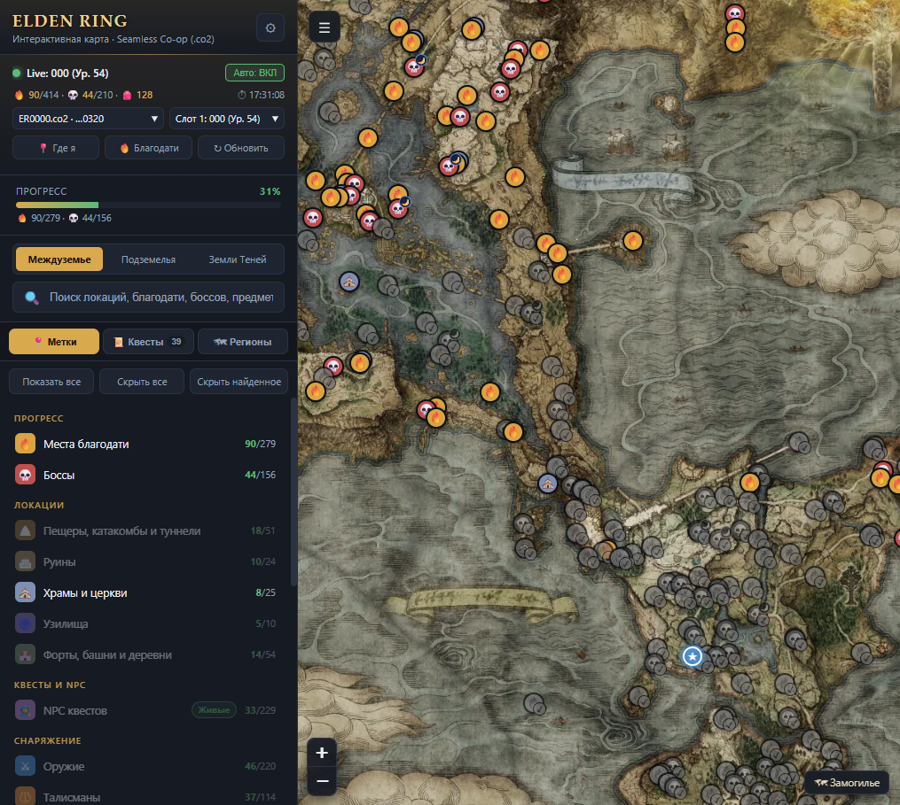
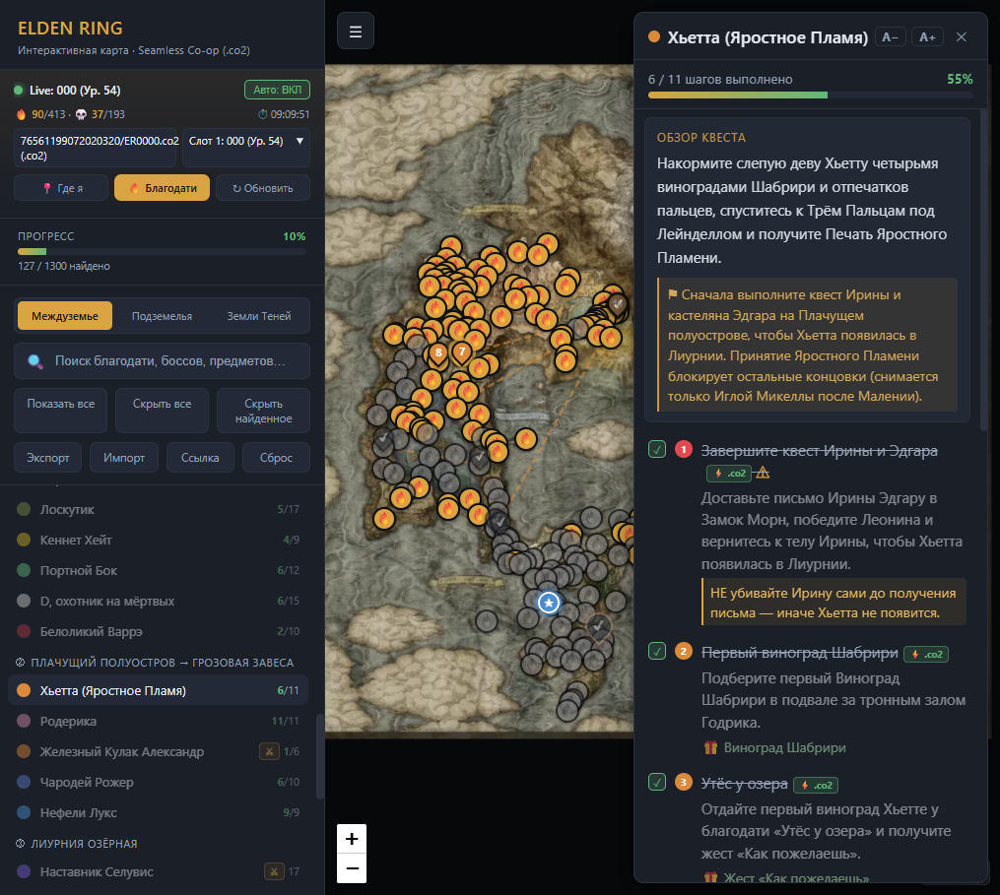

# Elden Ring Seamless Co-op (.co2) — Живая карта и трекер квестов

Полностью локальная, бесплатная и русифицированная интерактивная карта для **Elden Ring** и дополнения **Shadow of the Erdtree**, которая **сама в реальном времени** читает ваш файл сохранения (`.co2` от **Seamless Co-op** или обычный `.sl2`) и автоматически отмечает прогресс.



---

## Что умеет трекер

- **Автообновление карты в реальном времени (SSE)**: сервер отслеживает изменение сохранения по времени модификации, размеру и MD5-контрольной сумме слота (`%APPDATA%\EldenRing\<SteamID>\ER0000.co2`). Как только игра делает автосохранение, карта мгновенно обновляется и показывает кликабельное уведомление (`🔥 Открыта благодать`, `💀 Босс повержен`, `🎒 Предмет`, `📍 Локация`, `📜 Квест`).
- **414 мест благодати и 210 боссов** отмечаются автоматически по флагам событий из сохранения, включая **22 ночных и условных босса** с меткой `🌙` и условием появления (Ночная кавалерия, Птицы смерти, Охотники за колокольными сферами).
- **811 уникальных предметов** (оружие, талисманы, броня, чары и молитвы, прах духов, пеплы войны — включая вставленные в оружие, кристальные слёзы, великие руны и точильные клинки) автоматически отмечаются из инвентаря и сундука.
- **193 локации на карте** (пещеры/катакомбы/туннели, руины, храмы/церкви, узилища, форты, башни и деревни) с автоотметкой зачистки/посещения.
- **Точные ориентиры на любом масштабе**: места благодати и боссы никогда не объединяются в кластеры — их точное положение видно даже при максимальном отдалении.
- **Автоотслеживание 31 квестовой линии NPC** (базовая игра + DLC):
  - Проверяет EMEVD-флаги диалогов/стадий NPC, флаги мировых событий, предметы в инвентаре и сундуке, открытые благодати и убитых боссов (`⚡ .co2` — прямое подтверждение, `↳ Авто` — пройдено по цепочке).
  - Показывает статус NPC (`⚔ Враждебен` — нужно покаяние в Храме Клятв, `💀 Погиб`).
  - Предупреждает о точках невозврата и взаимоисключающих наградах.
  - Позволяет вручную отметить или снять любой шаг квеста (сохраняются в `localStorage` браузера).
- **Позиция персонажа (`📍 Где я`)**: показывает и центрирует карту на вашей текущей позиции в Междуземье и Землях Теней.
- **Полная русификация и сквозной поиск**: интерфейс, квесты, официальные русские названия локаций, боссов, предметов и благодатей; сквозной поиск работает по всем трём картам (`Междуземье`, `Подземелья`, `Земли Теней`) на русском и английском.

| Отслеживание квестов по `.co2` | Карта Земель Теней (DLC) |
| :---: | :---: |
|  |  |

## Безопасность

Трекер работает строго в режиме **read-only** (только чтение файла `.co2` / `.sl2` с диска). Он не модифицирует сохранение и не внедряется в память или процесс игры.

---

## Как запустить

### Вариант 1: Готовый `.exe` (без установки Python — удобно скинуть другу)
1. Скачайте **`EldenRingCoopTracker.exe`** из раздела [**Releases**](https://github.com/acneangelx/elden-ring-coop-tracker/releases).
2. Запустите файл двойным кликом — откроется консольное окно и вкладка с картой в браузере.
3. Консольное окно можно свернуть, но **не закрывайте его во время игры**.
4. В левом верхнем блоке выберите ваш файл `.co2` и слот персонажа (обычно выбирается автоматически).

### Вариант 2: Запуск из исходников
Требуется только Python 3.10+ (сторонние пакеты не нужны — используется только стандартная библиотека):
```powershell
git clone https://github.com/acneangelx/elden-ring-coop-tracker.git
cd elden-ring-coop-tracker
python server.py
```
Или просто запустите `start_tracker.bat`. Карта откроется на `http://127.0.0.1:8777` (если порт занят, автоматически выберется свободный из `8777..8787`).

---

## Как собрать `.exe` самостоятельно

```powershell
python -m venv .venv_build
.\.venv_build\Scripts\python.exe -m pip install pyinstaller
.\.venv_build\Scripts\python.exe build_exe.py
```
Собранный автономный файл появится в `dist\EldenRingCoopTracker.exe`.

---

## Структура проекта

- `server.py` — локальный HTTP + SSE сервер (раздаёт статику с диска или из встроенного `web.zip`).
- `er_save_parser.py` — бинарный парсер `.co2` / `.sl2` (BND4, флаги событий, инвентарь, сундук и вставленные пеплы войны, координаты игрока, оценка квестов, предметов и локаций).
- `data/eventflag_bst.txt` — карта смещений блоков флагов событий.
- `data/item_rules.json` — правила автоотметки 811 уникальных предметов, базовые ID праха и альтернативной брони.
- `data/location_rules.json` — правила автоотметки 193 локаций.
- `data/quest_rules.json` — правила автоопределения шагов для 31 квестовой линии.
- `web/` — фронтенд на Leaflet + локальные тайлы (`M00` Междуземье, `M01` Подземелья, `M10` Земли Теней), переведённые базы `markers.js` и `quests.js`, модуль `coop-sync.js`.
- `build_exe.py` — сборщик однофайлового `.exe` через PyInstaller.

## Благодарности и источники данных
- Офлайн-карта, тайлы, иконки и основа базы маркеров/квестов: [jw-ofs/elden-ring-map](https://github.com/jw-ofs/elden-ring-map)
- Структура бинарных сохранений `.sl2`/`.co2` и таблица смещений флагов: [ClayAmore/ER-Save-Lib](https://github.com/ClayAmore/ER-Save-Lib)
- Официальная русская локализация текстов базовой игры: [elden-ring-data/msg](https://github.com/elden-ring-data/msg)
- Справочник ID флагов событий NPC: [soulsmods/elden-ring-eventparam](https://github.com/soulsmods/elden-ring-eventparam)
